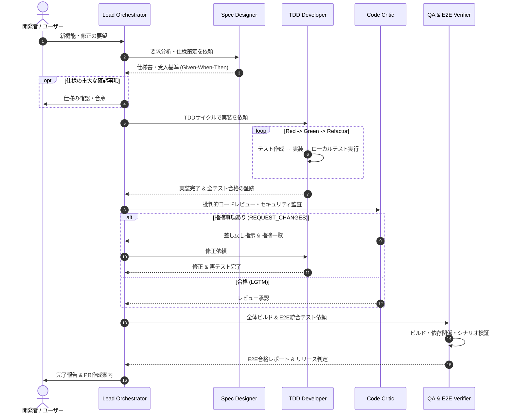

# AI-Driven Development (AIDD) Agent Team

本ディレクトリは、自律的かつ高品質なソフトウェア開発を実現するための「AI駆動開発（AIDD）専門エージェント群」のプロンプト仕様、運用チェックリスト、ワークフロー定義を格納しています。

---

## 1. チーム構成と責務

| エージェント名 | 責務・役割 | 主要入力 (Input) | 主要出力 (Output) | 主な権限 |
| :--- | :--- | :--- | :--- | :--- |
| **`lead-orchestrator`** | 開発全体の統括・パイプライン制御・ユーザー折衝 | ユーザー要望、各工程の報告 | サブエージェントへの指示、最終納品物 | Subagent呼び出し, 実行 |
| **`spec-designer`** | 要件定義・API/型設計・受入基準（Given-When-Then）策定 | 曖昧なユーザー要望、既存コード | 厳密なPRD/仕様書、受入基準、タスクWBS | コード読み取り, ドキュメント出力 |
| **`tdd-developer`** | テスト駆動開発（Red-Green-Refactor）、自己検証 | 仕様書、受入基準、コードベース | 実装コード、単体テスト、実行合格ログ | コード編集, コマンド実行 |
| **`code-critic`** | 批判的レビュー、セキュリティ監査、脆弱性チェック | 実装差分（Diff）、仕様書 | レビュー判定（LGTM / 差し戻し指示） | 読み取り専用（客観性担保） |
| **`qa-e2e-verifier`** | 全体ビルド、結合・E2Eテスト、リリース判定 | レビュー承認ブランチ、シナリオ | E2E実行ログ、動作保証レポート、PR要約 | コマンド実行, テストコード編集 |

---

## 2. ワークフロー（Standard Operating Procedure）

---

## 3. 各エージェントのプロンプト詳細
- [Lead Orchestrator](agents/lead-orchestrator.md)
- [Spec & Contract Designer](agents/spec-designer.md)
- [TDD Developer](agents/tdd-developer.md)
- [Adversarial Code & Security Critic](agents/code-critic.md)
- [QA & E2E Verifier](agents/qa-e2e-verifier.md)

## 4. テンプレート・チェックリスト
- [仕様書・受入基準テンプレート](specs/template_prd_and_spec.md)
- [コードレビュー・セキュリティチェックリスト](checklists/critic_code_review_checklist.md)
- [統合QA・E2E検証チェックリスト](checklists/qa_e2e_checklist.md)

## 5. CI/CD連携（GitHub Actions）
- ワークフロー定義: [`.github/workflows/aidd-critic.yml`](../.github/workflows/aidd-critic.yml)
- レビュー実行エンジン: [`.github/scripts/run_critic_review.py`](../.github/scripts/run_critic_review.py)
- PRテンプレート: [`.github/pull_request_template.md`](../.github/pull_request_template.md)

