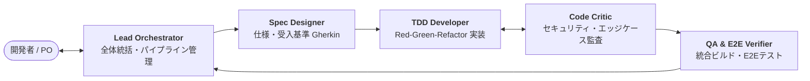

# AI-Driven Development Agents (`ai-driven-dev-agents`)

AI駆動開発（AIDD: AI-Driven Development）を実用レベルで自律稼働させるための、工程別専門エージェントチームの仕様・テンプレート集です。

Google Antigravity や Cursor、Claude Code、GitHub Copilot Workspace などのAIエージェント環境において、手戻りのない高品質な自律開発パイプラインを実現します。

---

## チーム概要



| エージェント | 役割 | 主な責務・アプローチ |
| :--- | :--- | :--- |
| [**Lead Orchestrator**](.agent/agents/lead-orchestrator.md) | 進行統括 | パイプライン制御、エージェント間の連携・差し戻し、人間との対話窓口 |
| [**Spec & Contract Designer**](.agent/agents/spec-designer.md) | 要件・仕様策定 | PRD作成、データ型・API仕様（OpenAPI）、受入基準（Given-When-Then） |
| [**TDD Developer**](.agent/agents/tdd-developer.md) | 実装・自己検証 | テスト駆動開発（Red-Green-Refactor）、全テストPassまでの自律ループ |
| [**Adversarial Code Critic**](.agent/agents/code-critic.md) | 批判的レビュー | OWASP Top 10セキュリティ監査、境界値・エッジケース、設計品質精査 |
| [**QA & E2E Verifier**](.agent/agents/qa-e2e-verifier.md) | 統合・E2E検証 | クリーンビルド、結合・E2Eテスト実行、マイグレーション検証、PR作成準備 |

---

## 使い方ガイド (Usage Guide)

### 🔰 初心者向け：おまかせフルオート開発（Quick Start）

プログラミングの詳細な知識がなくても、**統括エージェント（`lead-orchestrator`）に一言要望を伝えるだけ**で、仕様策定から実装・レビュー・テストまでが全自動で進行します。

#### ステップ 1: チャットで要望を伝える
AIアシスタントに作りたい機能や修正したい内容を伝えます。

> **プロンプト例:**
> ```text
> ユーザー登録・ログイン機能を作りたいです。
> ・メールアドレスとパスワードによる認証
> ・パスワードは安全にハッシュ化してDB保存
> ・JWTアクセストークンを発行
> lead-orchestrator を使って開発を進めてください。
> ```

#### ステップ 2: 仕様を確認して承認する（Human-in-the-Loop）
`spec-designer` が自動的に要件定義書と受入基準（Given-When-Then）を作成して提示します。
内容を確認し、問題なければ「**これで進めて**」と返答します。修正したい点があれば「〇〇も追加して」と指示します。

#### ステップ 3: あとは待つだけで完了
承認後は、人間の手を煩わせることなく自律的に裏側で作業が完結します：
1. `tdd-developer` がテストコードを書き、最小実装を行い、**テストが100%通るまで自己修正ループ**を回します。
2. `code-critic` が**セキュリティ脆弱性やエッジケースを厳しく審査**します（問題があれば自動差し戻し）。
3. `qa-e2e-verifier` が**全体のクリーンビルドと統合テスト**を実行し、動作を保証します。

すべての検証が成功すると、変更内容とテスト合格ログのサマリーが報告されます。

---

### 🚀 応用編：プロフェッショナル向け高度な活用術（Advanced Usage）

#### 1. 単体エージェントのピンポイント活用（スポット起用）
フルパイプラインを走らせる必要がない場面では、特定のエージェントのみを単体で呼び出して作業効率を最大化できます。

* **仕様策定・API設計のみを依頼したい時:**
  > 「`spec-designer` を使って、この要件に対するOpenAPIスキーマと、受入基準（Gherkin形式）を作成して。」
* **既存コードのセキュリティ診断・レビューのみを依頼したい時:**
  > 「`code-critic` を使って、最新のコミット差分のセキュリティ脆弱性（OWASP Top 10）や潜在的なバグを徹底レビューして。」
* **リファクタリングを安全に行いたい時:**
  > 「`tdd-developer` を使って、既存のテストがすべてPassすることを保証しながら、この関数の処理速度を改善して。」

#### 2. 既存プロジェクトへの導入（ポータビリティ）
本リポジトリの `.agent/` ディレクトリをコピーするだけで、既存のWebアプリやマイクロサービスに専属AIDDチームを配備できます。

```bash
# お手元の既存プロジェクト直下に配置
cp -r /Users/sanada_a/repo/ai-driven-dev-agents/.agent /path/to/your-existing-project/
```

#### 3. プロジェクト固有ルール・チェックリストの拡張
自社のコーディング規約やセキュリティガイドラインに合わせて、チェックリストを自由にカスタマイズできます。

* **[critic_code_review_checklist.md](.agent/checklists/critic_code_review_checklist.md)**:
  * プロジェクト固有の禁止API（例: Reactでの `dangerouslySetInnerHTML` 利用禁止）
  * 必須ミドルウェアや認可チェックのルールを追加
* **[template_prd_and_spec.md](.agent/specs/template_prd_and_spec.md)**:
  * チーム指定のドキュメントフォーマットや設計思想（DDD、クリーンアーキテクチャ等）を追加

#### 4. CI/CDパイプラインやGitHub Actionsとの統合
Pull Request作成時に `code-critic.md` のプロンプトをGitHub Actionで実行することで、**24時間365日稼働する自動AIレビュアー**としてCI/CDに組み込む運用が可能です。

---

## ディレクトリ構成

```text
ai-driven-dev-agents/
├── .agent/
│   ├── agents/                           # 各専門エージェントの定義・プロンプト
│   │   ├── lead-orchestrator.md          # 統括・オーケストレーター
│   │   ├── spec-designer.md              # 仕様策定・受入基準設計
│   │   ├── tdd-developer.md              # TDD実装・自己検証
│   │   ├── code-critic.md                # 批判的コードレビュー・セキュリティ
│   │   └── qa-e2e-verifier.md            # 統合検証・E2E
│   ├── specs/                            # 仕様書・設計テンプレート
│   │   └── template_prd_and_spec.md      # Gherkin受入基準付きPRDテンプレート
│   ├── checklists/                       # 各種品質チェックリスト
│   │   ├── critic_code_review_checklist.md  # レビュー・セキュリティチェックリスト
│   │   └── qa_e2e_checklist.md          # 統合QA・E2Eチェックリスト
│   └── README.md                         # エージェント運用ガイド
├── .gitignore
├── LICENSE
└── README.md                             # 本ドキュメント
```

---

## 特徴とコア設計思想

1. **仕様書駆動（Spec-Driven）**
   * 実装エージェントに直接コードを書かせるのではなく、まず `spec-designer` が受入基準（Given-When-Then）を明確化。後続のハルシネーションや認識ズレを未然に防ぎます。
2. **生成と評価の分離（Generative vs Adversarial）**
   * 実装者とは別の批判的ペルソナを持つ `code-critic` を独立させ、自己正当化バイアスを排除した厳格なコードレビューを実施します。
3. **自律的TDDループ（Self-Healing Loop）**
   * `tdd-developer` はローカル環境でテストを実行し、テストが全件パスするまで自己修復ループを回してから納品します。
4. **最小限の人間介入（Human-in-the-Loop）**
   * 人間は「仕様確定時」と「PRマージ前」の2箇所だけレビューすれば良いため、開発スピードとガバナンスを両立できます。

---

## ライセンス

[MIT License](LICENSE)
